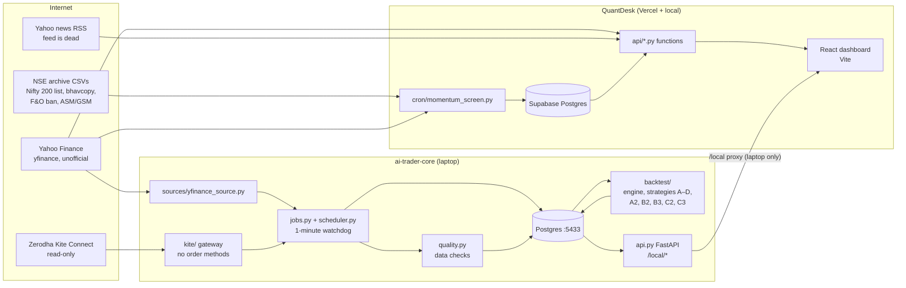
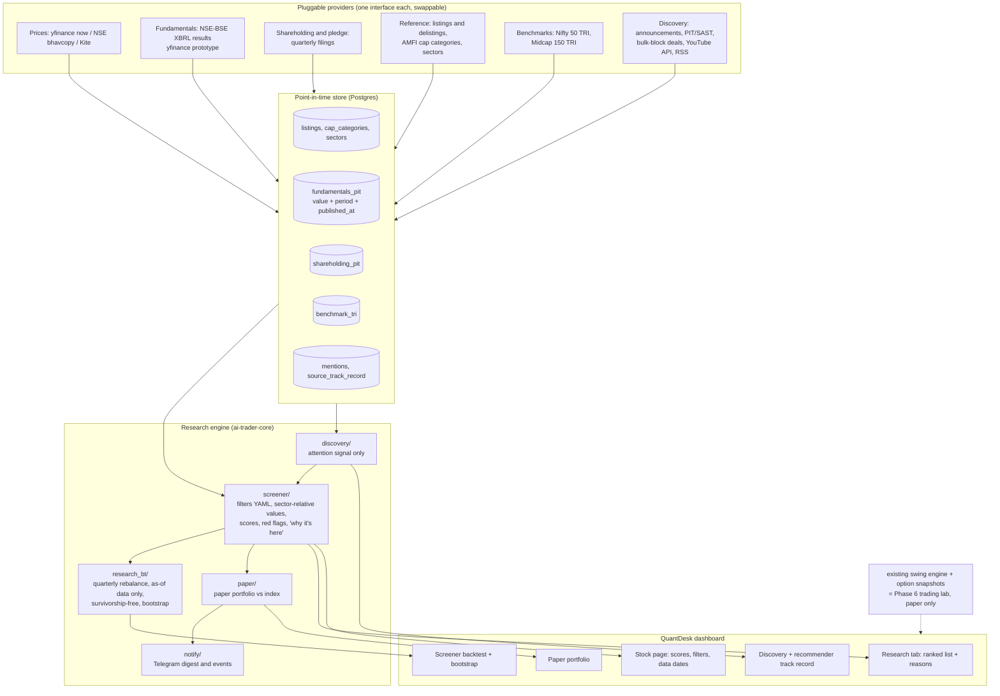

# QuantDesk Architecture

Phase 0 study, written 2026-11-05. Part 1 describes the system as it exists today. Part 2 proposes the target
architecture for the research and recommendation system in `docs/UPGRADE_PLAN.md`.

---

## Part 1: The system today

QuantDesk is two repositories that work together.

| Repo | What it is | Runs where | Database |
|---|---|---|---|
| `D:\ai-trader` (QuantDesk) | React dashboard + small Python API functions | Vercel (public site) and locally | Supabase Postgres (cloud) |
| `D:\ai-trader-core` (`aitrader`) | Data service, scheduler, backtest engine | Your laptop only, `127.0.0.1:8765` | Local Docker Postgres, port 5433 |

### 1.1 ai-trader-core: the data service and backtester

| Module | What it does |
|---|---|
| `universe.py` | Loads the Nifty 200 list from a CSV you downloaded, plus NIFTY 50 and NIFTY BANK. Today's list only, with no history of who was in it before. |
| `sources/yfinance_source.py` | Daily OHLCV bars from Yahoo, split-adjusted by Yahoo. This is where every price used in backtests comes from. |
| `kite/` | Kite Connect login, instrument list, quotes and historical candles. It has **no order, modify or GTT methods**, and `tests/test_kite.py` fails if one is added. |
| `jobs.py` | The jobs: `sync_instruments`, `snapshot_options` (NIFTY/BANKNIFTY option prices), `ingest_daily_bars`, `backfill_history`, `run_quality_checks`, `scan_history` (finds unadjusted splits). Every run is logged in `ingestion_runs`. |
| `scheduler.py` | A one-minute watchdog. It runs each of today's jobs once its time has passed (08:30, 15:35, 16:30, 16:45 IST), so jobs missed while the laptop slept still run. |
| `quality.py` | Data checks: missing bars, one-day jumps over 35%, likely unadjusted splits or bonuses. |
| `api.py` | FastAPI on `127.0.0.1:8765`: status, Kite login, job buttons, quality issues, backtest runs and report downloads. |
| `backtest/` | The swing backtest engine (below). |
| `__main__.py` | Command line: `serve`, `migrate`, `seed-universe`, `run-job`, `live-check`, `study`. |

**Database tables (14):**
- **Reference data:** `instruments`, `corporate_actions`, `index_membership`, `trading_calendar`.
- **Prices:** `daily_bars`, `option_contracts`, `option_snapshots`.
- **Kite login:** `kite_session`, holding the encrypted token.
- **Job runs and data checks:** `ingestion_runs`, `data_quality_issues`.
- **Backtests:** `backtest_runs`, `backtest_trades`, `backtest_equity`, `backtest_index_signals`.

**How the backtest engine works** (`backtest/engine.py`):
1. It loads every stock's daily bars and adds indicators (moving averages, ATR, RSI, returns).
2. It walks forward one trading day at a time. At each day's close a strategy proposes candidates using only data
   up to that day.
3. The candidates are bought at the **next day's open**, with slippage and Zerodha delivery charges.
4. Exits are checked daily against the stop, the target or trailing stop, and the time stop. If the stop and the
   target are both touched on the same day, it counts as a loss.
5. Money rules: risk per trade (fixed ₹ or % of equity), a per-stock cap, a cash check, a daily loss stop, the
   NIFTY 200-day regime filter, a charges-versus-risk check, a drawdown pause, a re-entry cooldown and drawdown
   risk scaling.
6. Results are split into "earlier" years and the last two "unseen" years, with a minimum-evidence checklist and a
   Markdown report plus CSVs.

It is a **swing-trading** engine: daily bars, trades lasting days to weeks, at most a few positions. It is not a
long-term portfolio backtester.

**Where the momentum strategy lives:**
- **QuantDesk:** `vercel-demo/momentum_screen.py`, with the Vercel cron `api/cron/momentum_screen.py`. This is the
  live screener behind the Momentum tab, which follows your `Momentum_Based_Short_Term_Stock_Strategy.md`.
- **Core:** `backtest/strategies/momentum.py` (A, short-term momentum) and `momentum_a2.py` (A2, 6- and 12-month
  momentum ranked weekly). A2 is the "reworked momentum strategy".

### 1.2 QuantDesk (`D:\ai-trader`): the dashboard

| Part | What it does |
|---|---|
| `vercel-demo/src/` | React (Vite) tabs: Day Trading, Short-Term, Swing / Long-Term, Top Movers, My Holdings, My Watchlist, Momentum, and the local-only Data and Backtest tabs. |
| `vercel-demo/api/*.py` | Vercel Python functions: `dashboard` (runs `recommender.py`), `search`, `holdings`, `watchlist`, `momentum`, and the `cron/momentum_screen` job. |
| `recommender.py` | The original recommender: a hard-coded mixed list (crypto, US and Indian stocks), scored on short-term momentum plus headline sentiment. Its RSS feed is dead. |
| `momentum_screen.py` | Momentum screen over the Nifty 200. Quality gates come from yfinance `.info` (market cap, debt/equity, earnings growth, and "promoter holding", which is really Yahoo's `heldPercentInsiders`), then a trend gate and a momentum score. Results go into `momentum_rankings`. |
| `sources/nse.py` | Downloads NSE archive CSVs: the Nifty 200 list, F&O ban, ASM/GSM lists and the bhavcopy. |
| `backtest.py` | An early SMA-crossover toy, now replaced by the core engine. |
| `dev_server.py` | Local stand-in for Vercel's `/api` routing. Vite also proxies `/local` to the core service. |
| Supabase tables | `holdings`, `watchlist` (keyed by a device id), `momentum_rankings`. |

### 1.3 What the plan's context gets wrong

These matter for the phases ahead.

1. **Market data is from Yahoo, not Kite.** All daily prices and fundamentals come from yfinance, which is
   unofficial. Kite is used only for its instrument list, NIFTY/BANKNIFTY option snapshots and a connection check.
   Kite Connect does not provide fundamentals.
2. **"~175% over 10 years":**
   - The momentum rework (A2) made about +177% in the **earlier** years (Aug 2017–Oct 2024). It was slightly
     negative in the unseen last two years (run #43: −0.4%).
   - Over the same period, NIFTY 50 bought and held did about +131%, using the **price index without dividends**.
   - The most consistent strategy so far is C3 (breakout): +130% earlier and +11.8% unseen.
   - So "beating the index" hasn't clearly happened yet.
3. **The benchmark is understated.** Backtests compare against the NIFTY 50 *price* index, not the **total return
   index (TRI)**, which adds back dividends (see `docs/learn/total-return-index.md`). Your rule 5 is right: TRI is
   the fair bar, and it's higher.
4. **Every existing backtest has survivorship bias.** The universe is today's Nifty 200, so companies that fell out
   of the index or were delisted are missing. Phase 3 must fix this, and it starts in Phase 1 (listing history).
5. **"Promoter holding" in the momentum screen isn't promoter holding.** Yahoo's `heldPercentInsiders` is a
   different number. Real promoter holding and pledges come from the quarterly shareholding patterns companies file
   with NSE/BSE.
6. **Two separate databases.** The public Vercel site cannot reach your laptop. Anything that needs the core service
   (Data, Backtest) only works on your machine.
7. **NSE archive downloads in `sources/nse.py` haven't been checked against NSE's terms of use** (rule 4). Phase 1
   should check them before relying on them further.
8. **Rule 1 already holds and is tested.** Neither repo has any order, modify or GTT call. The only matches for
   "place_order" are tests asserting it doesn't exist.

---

## Part 2: Target architecture (proposal)

### 2.1 Where the research system should live

**Recommendation: build the research system in `ai-trader-core`, not in the Vercel functions.**

- **Long jobs.** Phases 1–3 need a big, point-in-time database (years of quarterly results for about 2,000
  companies) and quarterly backtests over 10 years. Vercel functions are short-lived and stateless.
- **The patterns already exist** in the core: pluggable sources, job runs and data checks in Postgres, a scheduler, a
  FastAPI layer, and report and CSV export.
- **The dashboard stays the front end:** new React tabs read from the core API, as the Data and Backtest tabs do.

**Your decision needed:** the core service only runs while your laptop is on. To get the weekly digest and alerts
when it's off (Phase 5), or to see the research list on the public site, the core would need a small always-on server
later. That isn't needed for Phases 1–3.

### 2.2 Diagram

### 2.3 New modules (by phase)

| Phase | Module (in `ai-trader-core/aitrader/`) | Responsibility |
|---|---|---|
| 1 | `reference/` | All NSE equities with listing and delisting dates, AMFI Large/Mid/Small history (semi-annual), sector classification |
| 1 | `fundamentals/` | `FundamentalsProvider` interface, a yfinance prototype provider, a filings-based provider, and a point-in-time writer and reader (`as_of(date)`) |
| 1 | `benchmarks/` | Nifty 50 TRI and Nifty Midcap 150 TRI daily values |
| 2 | `screener/` | Filter config (YAML), sector medians, value, quality, growth and momentum scores (reusing the momentum code), red flags, plain-English explanations, saved screen runs |
| 3 | `research_bt/` | Quarterly-rebalance backtester on as-of data with a survivorship-free universe, costs, TRI benchmarks, bootstrap of rebalance returns, and a parameter-sensitivity (overfitting) check |
| 4 | `discovery/` | Corporate announcements and results deltas, insider (PIT), SAST and bulk/block deals, YouTube Data API and RSS mentions, and each source's track record at 3, 6 and 12 months |
| 5 | `notify/`, `paper/` | Telegram weekly digest and event alerts; a paper portfolio (fixed amount per stock, stock and sector caps) tracked against the index |
| 6 | (existing `backtest/` + `options.py`) | The trading lab, kept separate and paper-only |

**New tables (sketch, to be designed in each phase):**
- **Phase 1:** `listings`, `cap_categories`, `sectors`, `fundamentals_pit`, `shareholding_pit`, `benchmark_values`.
- **Phase 2:** `screen_runs`, `screen_results`, `red_flags`.
- **Phase 3:** `research_backtests`, `research_rebalances`.
- **Phase 4:** `mentions`, `mention_sources`.
- **Phase 5:** `paper_portfolios`, `paper_positions`, `alert_rules`, `alert_log`.

Every fundamentals row carries `period_end`, `published_at` (when the market could first know it) and `source`. A
query "as of date D" only sees rows with `published_at < D`.

**Dashboard:** a new Research tab (ranked list), a stock detail view (scores, filters passed and failed, data dates,
"why it's here"), and Discovery and Paper-portfolio tabs. All are read-only views over the core API.

**Learning:** `docs/learn/` gets one plain-English file per concept, as each phase introduces it.

### 2.4 Decisions to make before Phase 1

1. **Where the research engine runs:** laptop only for now (recommended), or a small always-on server later.
2. **Universe size:** all NSE equities (about 2,000) means about 10× more data than the Nifty 200. The plan's default
   screen is mid-cap, so Phase 1 could start with Large and Mid (top 250, AMFI) plus their histories, and add
   small-caps once the pipeline works.
3. **Fundamentals source:** Phase 1 will evaluate NSE/BSE XBRL filings against yfinance and recommend one after
   checking each source's terms. The likely trade-off: filings are official and point-in-time but harder to parse;
   yfinance is easy but unofficial, has gaps for Indian stocks, and has no publication dates.
